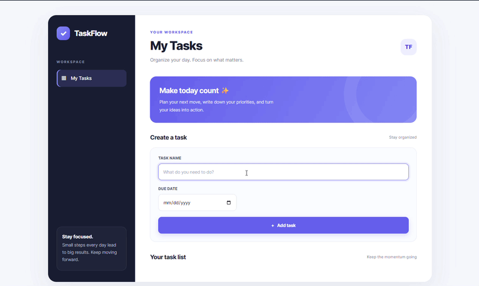
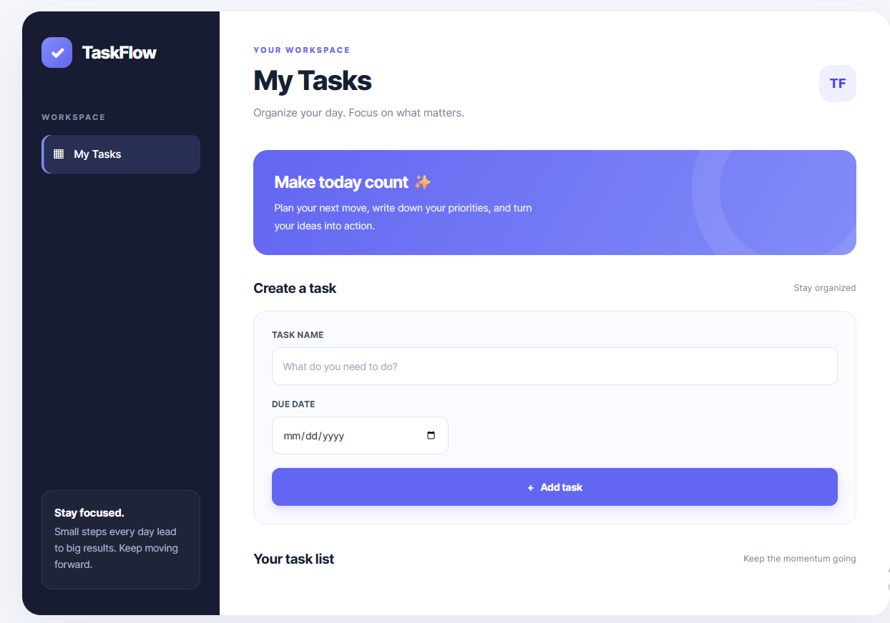
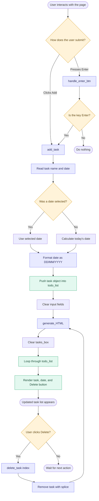

# TaskFlow --- Todo List

### A clean, responsive task manager built with HTML, CSS, and JavaScript.

## Preview

LINK



<br>



<br>


<br>


:::

------------------------------------------------------------------------

## Table of Contents

1.  [Short Project](#1-short-project)
2.  [Description](#2-description)
3.  [JavaScript Concepts](#3-javascript-concepts)
4.  [How the Functions Work](#4-how-the-functions-work)
5.  [Function Workflow Diagram](#5-function-workflow-diagram)
6.  [Installation and Usage](#6-installation-and-usage)


------------------------------------------------------------------------

## 1. Short Project

**TaskFlow** is a simple todo list application that lets users add tasks
with due dates and delete tasks when they are no longer needed.

The project is built to practise core JavaScript skills, especially
arrays, objects, functions, DOM manipulation, events, loops, and date
handling.

## 2. Description

### Features

-   Add a task by entering its name.
-   Choose a due date, or use today's date when no date is selected.
-   Display tasks and their dates on the page.
-   Delete a task from the list.
-   Add a task by clicking the **Add task** button or pressing **Enter**
    in the task-name input.
-   Responsive interface for desktop and mobile screens.

### Preview

```{=html}
<!-- Add a real screenshot or GIF to your repository, then replace this placeholder. -->
```
```{=html}
<!-- Example:  -->
```
> **Demo media:** Add a screenshot or GIF of your application here. For
> example, save it as `assets/taskflow-demo.gif` and uncomment the image
> line above.

### Technologies

  -----------------------------------------------------------------------
  Technology                          Role
  ----------------------------------- -----------------------------------
  HTML5                               Defines the input fields, button,
                                      and task container.

  CSS3                                Styles the dashboard and makes the
                                      layout responsive.

  JavaScript                          Stores tasks, handles events,
                                      formats dates, and updates the
                                      page.
  -----------------------------------------------------------------------

## 3. JavaScript Concepts

This project uses several important JavaScript fundamentals.

### 3.1 Variables and Constants

`let` is used for the task array because its contents change as tasks
are added or removed. `const` is used for values that are not reassigned
within a function.

``` js
let todo_list = [];

const todo_input = document.querySelector(".todo_input");
```

### 3.2 Arrays and Objects

Each task is stored as an object with a `name` and a `date` property.
The objects are kept inside the `todo_list` array.

``` js
let todo_list = [];

todo_list.push({
  name: "Learn JavaScript",
  date: "25/10/2026"
});
```

-   **Array:** stores the collection of tasks.
-   **Object:** represents one task and its properties.
-   **`push()`:** adds a task object to the end of the array.
-   **`splice()`:** removes an item from the array by index.

### 3.3 DOM Manipulation

The Document Object Model (DOM) lets JavaScript access and change HTML
elements.

``` js
document.querySelector(".todo_input");
```

In this project, `querySelector()` finds an element by its CSS class.
The code reads input values, clears fields, and updates the `.tasks_box`
container.

### 3.4 Events and Event Handling

The HTML uses event attributes to call JavaScript functions:

``` html
<button onclick="add_task()">Add task</button>
<input onkeydown="handle_enter_btn(event)" class="todo_input">
```

-   `onclick` calls `add_task()` when the button is clicked.
-   `onkeydown` calls `handle_enter_btn(event)` when a key is pressed.
-   `event.key` identifies which key was pressed.

For a larger application, `addEventListener()` is generally easier to
maintain because it separates JavaScript behavior from HTML markup.

### 3.5 Functions and Separation of Responsibilities

Each function has a specific job:

-   `add_task()` collects and stores the input.
-   `generate_HTML()` renders the current array on the page.
-   `delete_task(index)` removes a selected task.
-   `handle_enter_btn(event)` supports keyboard submission.

Keeping these responsibilities separate makes the code easier to
understand and improve.

### 3.6 Loops and Array Indexes

`generate_HTML()` uses a `for` loop to visit each task. The loop index
is also used to identify which task should be deleted.

``` js
for (let i = 0; i < todo_list.length; i++) {
  const object = todo_list[i];
  // Render this task.
}
```

Array indexes begin at `0`, so the first task has index `0`, the second
has index `1`, and so on.

### 3.7 Date Handling and Default Values

The date input returns a string in `YYYY-MM-DD` format when a date is
selected. If the field is empty, the code creates today's date using
`new Date()`.

``` js
const date_value =
  date_input.value ||
  `${today.getFullYear()}-${String(today.getMonth() + 1).padStart(2, "0")}-${String(today.getDate()).padStart(2, "0")}`;
```

The `||` operator uses the right-hand value when the input value is
empty. `getMonth()` is zero-based, so `+ 1` is required.
`padStart(2, "0")` keeps the month and day at two digits.

The code then splits the date into parts and displays it as
`DD/MM/YYYY`.

### 3.8 Template Literals

Backticks let JavaScript insert variable values into strings:

``` js
tasks_box.innerHTML += `
  <p>
    ${object.name}
    ${object.date}
    <button onclick="delete_task(${i})">Delete</button>
  </p>
`;
```

This is called a **template literal**. It makes it convenient to build
HTML strings, but user-provided text should not be inserted into
`innerHTML` without proper handling.

### 3.9 Array Mutation and Re-rendering

When a task is deleted, `splice()` changes the original array. Calling
`generate_HTML()` afterward redraws the list so the interface matches
the data.

``` js
function delete_task(index) {
  todo_list.splice(index, 1);
  generate_HTML();
}
```

This demonstrates a basic UI pattern: **update the data, then update the
displayed interface**.

## 4. How the Functions Work

### `add_task()`

**Purpose:** Read the user's input, determine the task date, store the
task, clear the form, and refresh the task list.

Step by step:

1.  Select the task-name and date inputs.
2.  Read the task name.
3.  Use the selected date, or calculate today's date if the date field
    is empty.
4.  Convert the date from `YYYY-MM-DD` to `DD/MM/YYYY`.
5.  Push a new `{ name, date }` object into `todo_list`.
6.  Clear both input fields.
7.  Call `generate_HTML()` to refresh the displayed tasks.

**Current limitation:** The function does not prevent an empty task name
from being added. Input validation would improve it.

### `generate_HTML()`

**Purpose:** Display all task objects in the `todo_list` array.

Step by step:

1.  Select the `.tasks_box` container.
2.  Clear its current content using `innerHTML = ""`.
3.  Loop through the array.
4.  Read each task object.
5.  Add its name, date, and a Delete button to the container.
6.  Pass the task's array index to `delete_task(index)`.

The function redraws the complete list each time it runs. This is
straightforward for a small learning project.

### `delete_task(index)`

**Purpose:** Remove one task.

Step by step:

1.  Receive the index of the selected task.
2.  Use `splice(index, 1)` to remove one item at that index.
3.  Call `generate_HTML()` so the remaining tasks appear on the page.

### `handle_enter_btn(event)`

**Purpose:** Allow the user to add a task by pressing Enter.

``` js
function handle_enter_btn(event) {
  if (event.key === "Enter") {
    add_task();
  }
}
```

The function checks whether the pressed key is `"Enter"`. If it is, it
calls `add_task()`. Otherwise, it does nothing.

## 5. Function Workflow Diagram

The diagram below shows how user actions flow through the functions and
how the array and page stay in sync.



### The key idea

`todo_list` is the **data source** for the displayed task list.

-   Adding a task changes the array, then redraws the page.
-   Deleting a task changes the array, then redraws the page.
-   `generate_HTML()` reads the current array to decide what should be
    displayed.

This is a simple example of keeping application data and the user
interface synchronized.

## 6. Installation and Usage

### Requirements

-   A web browser.
-   A code editor such as [Visual Studio
    Code](https://code.visualstudio.com/).
-   Basic knowledge of HTML, CSS, and JavaScript.

### Installation

1.  Clone the repository:

    ``` bash
    git clone https://github.com/YOUR_GITHUB_USERNAME/taskflow-todo-app.git
    ```

2.  Open the project folder:

    ``` bash
    cd taskflow-todo-app
    ```

3.  Open `index.html` in your browser, or use the **Live Server**
    extension in Visual Studio Code.

### Usage

1.  Enter a task name.
2.  Optionally choose a due date.
3.  Click **Add task** or press **Enter** in the task-name field.
4.  If no date is selected, today's date is used.
5.  Click **Delete** to remove a task.

> **Note:** Tasks are currently stored in a JavaScript array. Refreshing
> the page clears the list because the project does not yet save tasks
> to persistent storage.


### What I Learned

-   How to store related data using arrays and objects.
-   How to select and update HTML elements using the DOM.
-   How to respond to click and keyboard events.
-   How to write functions with separate responsibilities.
-   How to format dates and provide a default value.
-   How to update the interface after adding or deleting data.
-   Why input validation, persistent storage, and safe DOM rendering
    matter.

### Future Goal

Evolve TaskFlow from a simple todo list into a more complete task
manager with task completion, editing, filters, and persistent storage.

------------------------------------------------------------------------

::: {align="center"}
**Built as a JavaScript learning project.**
:::
